# KRONOSbothub v2.0 ReVamPed by AMG

**KRONOSbothub v2.0 ReVamPed** is AMG's revamped edition of Bothub, the AutoIt automation hub for **Guild Wars 1**.
AMG revamped Bothub on top of the original project by caustic-kronos
([caustic-kronos/BotsHub](https://github.com/caustic-kronos/BotsHub)): the original framework and farms are kept, and
this edition adds inventory, extraction, storage, farming and quality-of-life work, plus an optional faster memory
bridge (GWBridge).

This is a clean copy for anyone to try: it ships with **no personal data**. Only the default settings and the
optional **Masterloot** loot configuration are included. Your own configurations are created when you press **Save**.

> ⚠️ The bot acts on its own (picking up, identifying, extracting, salvaging, storing and selling items). Store
> anything valuable in Xunlai storage before you run it. The authors are not responsible for lost items or
> unintended behaviour.
>
> ⚠️ Not affiliated with or endorsed by ArenaNet or NCSoft. Guild Wars is a trademark of its owners. Using automation
> may be against the game's terms of use. Use it at your own risk.

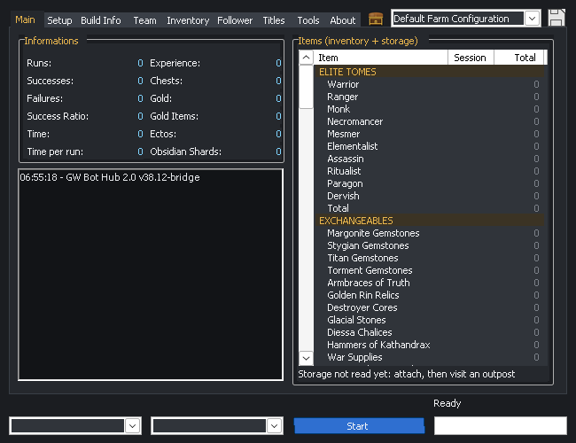

---

## Contents

- [Requirements](#requirements)
- [Install](#install)
- [First run](#first-run)
- [Attach to Guild Wars first](#attach-to-guild-wars-first)
- [Running a farm](#running-a-farm)
- [Automatic component extraction](#automatic-component-extraction)
- [The tabs](#the-tabs)
- [Configurations: farm settings, loot and Masterloot](#configurations-farm-settings-loot-and-masterloot)
- [GWBridge (faster reads)](#gwbridge-faster-reads)
- [Known issues](#known-issues)
- [Logs](#logs)
- [What this edition adds](#what-this-edition-adds)
- [Build data](#build-data)
- [Feedback](#feedback)
- [Credits](#credits)
- [License and disclaimer](#license-and-disclaimer)

---

## Requirements

- **Guild Wars 1** (the original Guild Wars, not Guild Wars 2), installed and logged in to a character.
- **Windows** with **AutoIt 3.3.16.1 or later**, run in **32-bit (x86)** mode (tested with 3.3.18.0). The bot
  refuses to start in 64-bit mode ("Please run all bots in 32-bit (x86) mode.").
- **Administrator rights.** `BotsHub.au3` asks for them (`#RequireAdmin`); the first log line says `admin yes` or
  `admin NO`.
- Run the game **without add-ons**: no GWToolbox++, no Py4GW, no cartography tools, no ReShade.

## Install

1. Download this repository (**Code → Download ZIP**) or clone it.
2. Extract it into its own folder, for example `C:\Bothub\`.
3. Keep the folder structure as it is. `bridge\bin\` must contain `GWBridge.dll` and `gwca.dll` (some antivirus
   tools quarantine DLLs that get loaded into other programs; if they go missing the bot simply runs without the
   bridge).
4. Run **`BotsHub.au3`** directly with 32-bit AutoIt (right-click → *Run Script (x86)*, or open it with
   `AutoIt3.exe`). There is nothing to compile. Do **not** run the individual files under `src/`.

## First run

On a fresh copy there is no saved state. The bot starts with:

- run settings from `conf/farm/Default Farm Configuration.json` (shown in the template box at the top right),
- loot settings from `conf/loot/Default Loot Configuration.json` (everything unticked).

Folders such as `logs/` and `cache/` are created by the bot when it needs them.

## Attach to Guild Wars first

Everything that talks to the game (Start, the Xunlai chest button, **Open Storage**, **Sort now**, **Empty Tab**,
**Manually extract selected components**, the Titles tab buttons, Ecto/Gold conversions, the Follower) needs the bot
to be **attached** to your running Guild Wars client. Attach first:

1. Start Guild Wars and log in to the character you want to use.
2. Run `BotsHub.au3`.
3. Click the arrow of the **character box** at the bottom left (it shows "No character selected" until you pick
   one). Opening it scans the running Guild Wars clients and lists their logged-in characters. Pick yours.
4. Attach in one of two ways:
   - **Tools** tab → **Attach to Guild Wars**. A message says "Attached successfully. Tools are ready." and the
     Tools tab shows **Attached**. Use this when you only want the tools.
   - Or pick a farm and press **Start**: Start attaches to the selected character by itself. If you already
     attached from Tools, Start reuses that attachment.
5. When attached, the bot renames the Guild Wars window to the character's name.

If you use a tool without attaching, it does nothing and the log says so, for example:
`[Storage] Not attached to Guild Wars - use Tools > Attach or start a farm first. Storage not opened.`

Storage moves (**Sort now**, **Empty Tab**) only work in an **outpost or town**; in explorable areas the storage is
view-only.

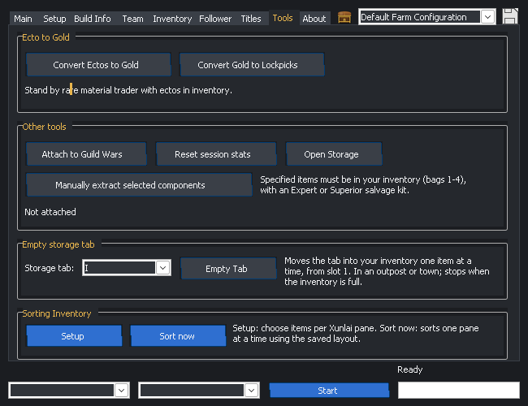

## Running a farm

1. Attach (above), then choose a farm in the **farm box** (bottom, middle-left). The **Build Info** tab shows the
   build and notes for the selected farm.
2. Check the **Setup** tab (run options) and the **Inventory** tab (what to pick up, store, extract, salvage and
   sell). Press **Apply changes** on the Inventory tab after changing ticks.
3. Press **Start**. While it runs the button reads **Pause**; pressing it lets the current run finish and then
   pauses.

## Automatic component extraction

Extraction takes the upgrade components you choose (mods, inscriptions, runes and insignias) out of the items in
your bags before they are salvaged for materials or sold. It is **off by default**. To turn it on:

1. **Setup** tab → **Inventory management** group → tick **Extract selected components before selling**.
2. **Inventory** tab → open the **Extract Components** branch and tick what you want to keep:
   - **Armor upgrades** (runes and insignias, under *All* or a profession),
   - **Inscriptions** (*Weapon*, *Offhand* and the *Measure for measure* / *Show me the money* groups),
   - **Mods** (by weapon type: Axe, Bow, Dagger, Focus, Hammer, Scythe, Shield, Spear, Staff, Sword, Wand).

   Only perfect (max-roll) options are listed, plus the Minor/Major runes. Ticking a branch ticks everything inside
   it. Then press **Apply changes** (or **Save** to keep the ticks in a loot file).
3. Have an **Expert** or **Superior Salvage Kit** in your bags. During the automatic town pass, if none is left the
   bot buys an Expert Salvage Kit from the merchant (at most 5 per pass).

How it works in the code: in town, after a run and **before** salvaging for materials and selling, the bot looks at
the items in your bags (bags 1-4; not equipped; identified) and extracts each ticked component it finds with the
kit. An item that still holds a ticked component is never salvaged for materials or sold. Items protected by the
Inventory tab's **Store items** ticks always win. Loose components can then be stored through
**Store items → Components**.

To extract right away instead, use **Tools → Manually extract selected components** (needs the same Extract
Components ticks and a kit in your bags; it does not buy a kit and does not need the Setup checkbox).

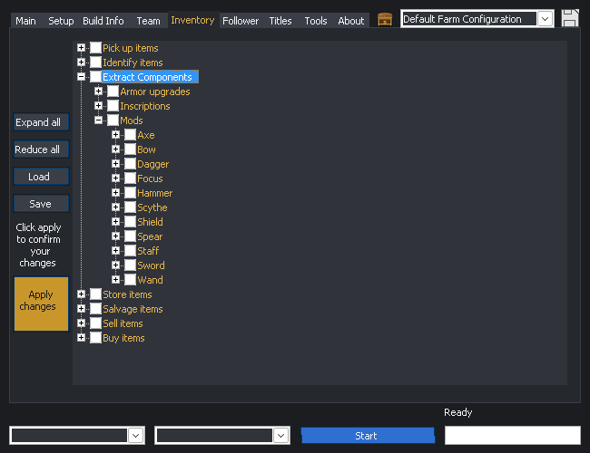

## The tabs

| Tab | What it is for |
|---|---|
| **Main** | Run statistics (*Informations*), the log console and the *Items (inventory + storage)* panel with Session and Total counts. |
| **Setup** | Run options (loop, hard mode, district, consumables...), faction options, *Inventory management* (including *Salvage into materials* and *Extract selected components before selling*), other options and actions (*Open Storage*, *Disable Graphics*). |
| **Build Info** | Skill bars and notes for the selected farm. |
| **Team** | Heroes and optional hero/player build templates. No builds are pre-filled; paste your own template codes and tick *load*. |
| **Inventory** | The loot tree: Pick up items, Identify items, Extract Components, Store items, Salvage items, Sell items, Buy items. Buttons: Expand all, Reduce all, Load, Save, Apply changes. |
| **Follower** | ⚠️ **Under construction.** Follows a party leader by exact character name (*Start Follower*), with leash and options. Everything works except **Bonder Mode**, which is not working yet: leave it on *None*. |
| **Titles** | Reputation and consumable title progress, with *Eat all sweets*, *Drink all alcohol* and *Use all party items*. |
| **Tools** | Ecto/Gold conversions, **Attach to Guild Wars**, *Reset session stats*, *Open Storage*, *Manually extract selected components*, *Empty storage tab*, and **Sorting Inventory** (*Setup* and *Sort now*). |
| **About** | About this edition, the original project link and the feedback email. |

The **Xunlai chest** button at the top right opens your storage from any tab (once attached). Next to it are the
**template box** (saved farm settings) and the **save** icon.

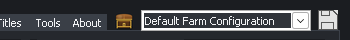

| | |
|---|---|
| 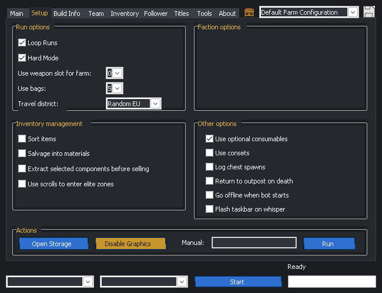 | 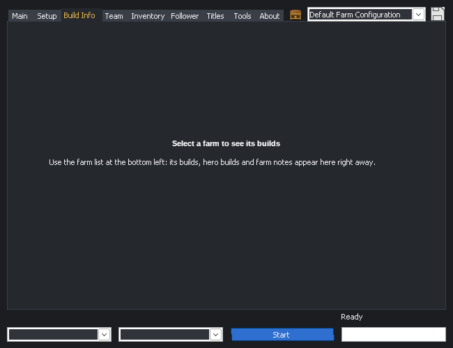 |
| 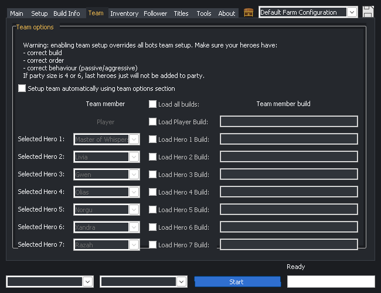 | 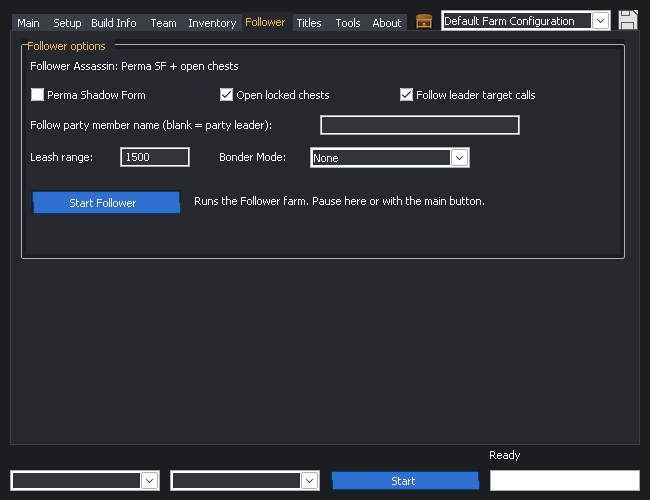 |
| 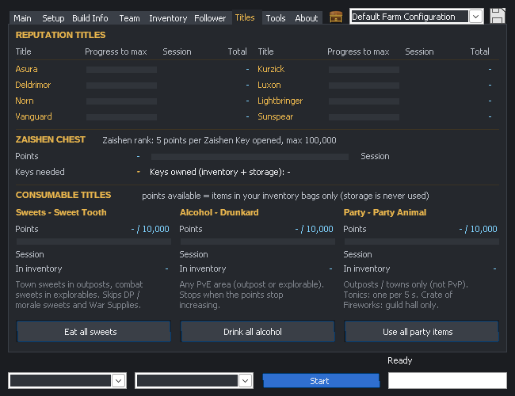 | 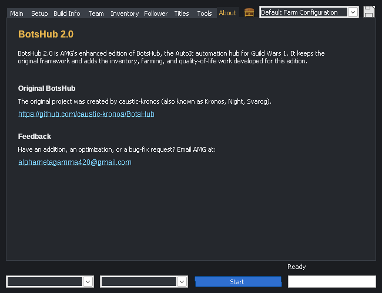 |

### Tools tab

Attach first (see above). Stand in an outpost or town for the trading tools.

- **Convert Ectos to Gold**: sells **all** Globs of Ectoplasm in your bags, one at a time, to a Rare Material
  Trader (the nearest NPC; in Eye of the North and Embark Beach it walks to the known trader, and if the trader does
  not answer it travels to Eye of the North once). It quotes, sells, confirms, then sells the next one. Before a
  sale would take your carried gold over the **100,000** cap it deposits your gold into Xunlai storage and goes on.
  It stops when no ectos are left, when storage gold is full (1,000,000) or when the trader does not answer.
  Ectos already in storage are not sold.
- **Convert Gold to Lockpicks**: spends your gold on Lockpicks at a merchant that sells them (the nearest NPC,
  otherwise it travels to the Eye of the North merchant). It buys in batches of up to 80, at 1,500g each, or 1,200g
  at Factions alliance-discount merchants. When carried gold runs short it **withdraws gold from storage** and keeps
  buying. It stops when there is no gold left in your bags or storage, or when your bags (1-4) have no room for
  more lockpicks. No gold reserve is kept.
- **Attach to Guild Wars**: attaches to the character selected in the character box.
- **Reset session stats**: resets the session counters on the Main tab.
- **Open Storage**: opens the Xunlai storage window (view-only in explorable areas). The chest button at the top
  right does the same from any tab.
- **Manually extract selected components**: see [Automatic component extraction](#automatic-component-extraction).
- **Empty storage tab** → **Empty Tab**: moves every item of the chosen storage tab (I to XIII, Anniversary) into
  your bags, in an outpost or town.
- **Sorting Inventory** → **Setup** / **Sort now**: see below.

### Storage Setup and Sort now

**Tools → Sorting Inventory → Setup** opens the Storage Setup page: scan your Xunlai panes in an outpost, choose
which items belong in which pane, then **Save** the layout (layouts are saved in `conf/storage`) and **Apply
changes**. **Sort now** sorts by hand only: one item move at a time, pane by pane, at least 0.10 s apart, in an
outpost or town. Nothing sorts automatically.

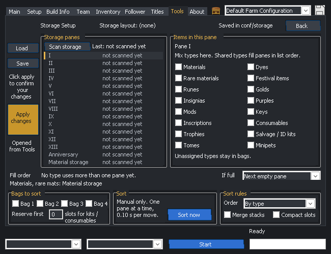

## Configurations: farm settings, loot and Masterloot

- **Farm settings templates** (`conf/farm/`): the box at the top right lists them. Pick one to load it. Press the
  **save** icon to save the current settings under a new name; it then appears in the box. Only
  `Default Farm Configuration` ships.
- **Loot configurations** (`conf/loot/`): on the **Inventory** tab, **Load** opens a loot file, **Save** writes the
  current ticks to a file, and **Apply changes** uses the current ticks for this session.
  `Default Loot Configuration` (all unticked) loads at start.
- **Masterloot** (`conf/loot/Masterloot.json`): a complete, ready-made loot configuration included for anyone who
  wants it. Load it from the Inventory tab, review the ticks, then **Apply changes**.
- Your own configurations are only created when you press **Save**.

## GWBridge (faster reads)

This edition includes **GWBridge** (`bridge/`): a small helper DLL loaded into the Guild Wars client when the bot
attaches. Game reads (position, energy, skill recharge, map, target, bags) then come from one shared-memory snapshot
per frame instead of many separate memory reads, so the bot runs smoother. Every action still goes through the
normal GWA2 code.

- If the bridge cannot load, the bot runs classic GWA2 and logs why:
  `GWBridge: ACTIVE - ...` or `GWBridge: OFF - classic GWA2 for everything. Reason: ...`.
- It will not load if GWToolbox++ or Py4GW is running or loaded in the client.
- Attaching takes a moment the first time (the helper scans the game once); the game may hitch briefly.

Details and log messages: [`bridge/TESTING.md`](bridge/TESTING.md).

## Known issues

- **Follower tab: under construction.** Following a leader works; **Bonder Mode** (*Monk Bonder*, *EleMonk UW
  Bonder*) is not working yet. Leave Bonder Mode on *None*.
- The first attach with GWBridge can make the game hitch for a second or two while the helper scans the game once.

## Logs

Logs are written to `logs/` next to `BotsHub.au3`: `botshub-YYYY-MM-DD-<character>.log` (every log line) and
`runs-YYYY-MM-DD.csv` (one line per run). When asking for help, send the log file; its first line describes your
setup (version, AutoIt, OS, admin rights). Remove character names from it first if you want to stay private.

## What this edition adds

Highlights (see [`CHANGELOG.md`](CHANGELOG.md) for every change):

- GWBridge shared-memory reads with automatic fallback, plus faster classic memory reads and bag scans.
- Extract Components: perfect-only extraction of mods, inscriptions, runes and insignias before selling, manual
  extraction from Tools, held items never sold or salvaged.
- Store items → Components, Store-ticked items never sold, Masterloot.
- Items panel with inventory + storage totals and per-session gains; Titles tab; Build Info tab.
- Storage Setup and manual **Sort now**; **Empty Tab**; the Xunlai chest button on every tab.
- Map-load guard and a stuck watchdog that resets a run instead of hanging.
- Follower with exact leader-name matching; dark theme; About tab.

## Build data

- Version: **v38.12-bridge** (see [`VERSION`](VERSION) and [`BUILD-INFO.md`](BUILD-INFO.md)).
- [`BUILD-INFO.md`](BUILD-INFO.md) lists the SHA-256 hash of every file in this release.
- Developer notes: [`ANALYSIS.md`](ANALYSIS.md), [`CHANGELOG-FIXES.md`](CHANGELOG-FIXES.md),
  [`TESTING.md`](TESTING.md), and the original project's README in
  [`doc/BotsHub original README.md`](doc/BotsHub%20original%20README.md).

## Feedback

Have an addition, an optimization or a bug-fix request? Email AMG at **alphametagamma420@gmail.com**.

## Credits

- **AMG** revamped Bothub: KRONOSbothub v2.0 ReVamPed by AMG (edition author and maintainer).
- **caustic-kronos** (also known as Kronos, Night, Svarog), author of the original Bothub:
  [github.com/caustic-kronos/BotsHub](https://github.com/caustic-kronos/BotsHub).
- **The GWA2 community.** The GWA2 library in `lib/` credits gigi, tjubutsi and Greg-76 (`GWA2.au3`,
  `GWA2_Assembly.au3`), Greg-76 and KleuTSchi (ID files), and for `GWA2_Headers.au3` rheek, mhaendler, 3vcloud,
  MrJambix and night (source: [github.com/rheek123/GwBotApiPatcher](https://github.com/rheek123/GwBotApiPatcher)).
- **The GWCA community.** GWBridge uses GWCA (Guild Wars Client API), shipped as the prebuilt `gwca.dll` from
  [GWToolbox++](https://github.com/gwdevhub/GWToolboxpp); GWCA itself:
  [github.com/GregLando113/GWCA](https://github.com/GregLando113/GWCA).
- Farm script authors and contributors are listed per file in [`CREDITS.md`](CREDITS.md).

## License and disclaimer

Bothub is licensed under the Apache License 2.0 ([`LICENSE`](LICENSE)), copyright 2025 caustic-kronos. Parts of the
code come from other projects under their own licenses, as listed in [`CREDITS.md`](CREDITS.md).

This software is provided "as is", without warranty of any kind. It is not affiliated with or endorsed by ArenaNet
or NCSoft. Use it at your own risk and follow the rules of the game you play.
